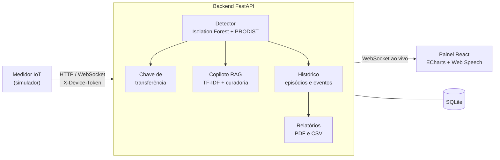

<p align="center">
  
</p>

<h1 align="center">Sentinela TO</h1>

<p align="center">
  <strong>Telemetria IoT e inteligência preditiva para proteção energética da indústria tocantinense</strong>
</p>

<p align="center">
  <a href="https://github.com/lucascaua-exe/sentinela-to/actions/workflows/ci.yml"></a>
  
  
  
  
</p>

---

O **Sentinela TO** monitora em tempo real a energia trifásica que entra numa fábrica. Ele detecta anomalias com Machine Learning e, antes que a falha da rede queime motores ou pare a produção, comuta a planta para autoprodução (solar + baterias). Um copiloto de IA explica a causa provável, cita as normas aplicáveis e registra cada ocorrência para análise e relatórios.

## Funcionalidades

- **Detecção preditiva**: um Isolation Forest, combinado com as regras do PRODIST Módulo 8, identifica afundamentos, sobretensões, falta de fase, desequilíbrio, harmônicos e a degradação sutil que antecede uma falha.
- **Chave de transferência automática**: armada no evento crítico, comuta em 5 s (3 s em queda de fase), filtra transitórios e permite cancelamento pelo operador.
- **Copiloto de diagnóstico (RAG)**: indica a causa raiz, as ações imediatas e preventivas e as referências normativas, com índice de confiança e narração por voz em português.
- **Aprendizado ativo**: diagnósticos com confiança abaixo de 90% entram numa fila de curadoria. A validação pela engenharia retreina a base sem reiniciar o sistema.
- **Histórico e relatórios**: linha do tempo das ocorrências com filtros, indicadores e exportação em PDF com a identidade visual ou em CSV.
- **Multiunidade**: Palmas, Araguaína, Gurupi e Porto Nacional, cada uma com análise, chave de transferência e histórico próprios.
- **Segurança**: login com PBKDF2-SHA256, sessão em cookie HttpOnly, limite de tentativas e token por dispositivo IoT.

## Arquitetura



| Camada | Tecnologias |
| --- | --- |
| Backend | Python, FastAPI, Uvicorn, Pydantic |
| IA | scikit-learn (Isolation Forest, TF-IDF), LLM opcional compatível com a API da OpenAI |
| Frontend | React 18 e ECharts via CDN, sem etapa de build |
| Dados | SQLite (usuários, preferências, histórico e curadoria) |
| Relatórios | ReportLab |
| Infraestrutura | nginx, systemd |

## Início rápido

Requisitos: Python 3.10 a 3.12 e um navegador com acesso à internet, para carregar o React por CDN.

```powershell
git clone git@github.com:lucascaua-exe/sentinela-to.git
cd sentinela-to
.\run_demo.ps1
```

O script cria o ambiente virtual, instala as dependências, inicia o backend e o simulador e abre o painel. Para rodar manualmente:

```bash
python -m venv .venv
.venv/Scripts/python -m pip install -r requirements.txt     # Linux/macOS: .venv/bin/python

.venv/Scripts/python -m uvicorn backend.main:app --port 8000  # terminal 1: API e painel
.venv/Scripts/python simulator/iot_emulator.py              # terminal 2: medidor IoT
```

| Endereço | Conteúdo |
| --- | --- |
| http://localhost:8000 | Painel do operador |
| http://localhost:8000/docs | Documentação interativa da API |

Na primeira execução, o backend cria o usuário `admin` e mostra a senha uma única vez no terminal. Para criar usuários ou redefinir senhas:

```bash
python -m scripts.create_user <usuario>
```

## Configuração

Todas as variáveis são opcionais.

| Variável | Descrição | Padrão |
| --- | --- | --- |
| `SENTINELA_ADMIN_USER` | Usuário administrador criado na primeira execução | `admin` |
| `SENTINELA_ADMIN_PASSWORD` | Senha desse administrador | gerada e exibida no log |
| `SENTINELA_DEVICE_TOKEN` | Token exigido dos medidores IoT | gerado em `data/device.token` |
| `SENTINELA_DB_PATH` | Caminho do banco SQLite | `data/sentinela.db` |
| `OPENAI_API_KEY` | Ativa a redação do diagnóstico por um LLM | compositor local |
| `OPENAI_BASE_URL` | Endpoint compatível com a API da OpenAI | `https://api.openai.com/v1` |
| `SENTINELA_LLM_MODEL` | Modelo do LLM | `gpt-4o-mini` |

Os parâmetros econômicos da estimativa de perdas evitadas (custo da hora parada e da troca de motor) ficam em `ECONOMICS`, em `backend/main.py`.

## Como funciona

1. **Detecção**: o Isolation Forest é treinado com o perfil normal da planta, a partir de 9 variáveis elétricas. Uma janela móvel confirma a anomalia antes de elevar a severidade, e as faixas da ANEEL (tensão adequada de 202 a 231 V, desequilíbrio até 3%, THD até 10%) explicam a causa.
2. **Proteção**: o evento crítico arma a chave de transferência. Se a rede não normalizar, a planta vai para autoprodução e volta à concessionária, com sincronismo, depois de 10 s de rede estável.
3. **Diagnóstico**: a base técnica em `backend/ai/knowledge/` (IEEE 1159, PRODIST Módulo 8, NBR 5410, manutenção de motores e notas regionais) é recuperada para cada distúrbio. A confiança é calculada assim:

   `CS = 0,7 × similaridade vetorial + 0,3 × densidade de evidência`

4. **Curadoria**: abaixo de 90% de confiança, o diagnóstico vira hipótese com passos de contingência e é registrado como lacuna. A resolução validada pelo engenheiro passa a fazer parte da base.
5. **Registro**: cada ocorrência vira um episódio com severidade de pico, distúrbios, extremos medidos, comutação, diagnóstico e a sequência de eventos.

## Cenários de demonstração

Troque o cenário ao vivo pela barra do painel (teclas **1** a **5**) ou com `--mode` no simulador.

| Cenário | Simulação | Resposta |
| --- | --- | --- |
| `NORMAL` | Rede estável em 220 V | Normal |
| `PRE_FAULT` | Degradação lenta e sutil | Atenção (percebida primeiro pela IA) |
| `SAG_PALMAS` | Queda de ~22% nas fases A e B com sobrecorrente | Crítico, com comutação |
| `SWELL` | Sobretensão de ~15% | Crítico, com comutação |
| `PHASE_LOSS` | Fase C em 0 V | Crítico, com comutação em 3 s |
| `PHASE_IMBALANCE` | Falta de fase parcial | Crítico, com comutação |
| `HARMONIC` | THD acima de 10% | Atenção |
| `BLACKOUT` | Interrupção total | Crítico, com comutação |

O benchmark `python -m scripts.benchmark_detector` registra nenhum falso alarme em 1.000 amostras normais, todos os distúrbios detectados e latência média de cerca de 1,6 ms por pacote.

## API

Todos os endpoints, exceto os de telemetria e saúde, exigem sessão autenticada. A referência completa fica em `/docs`.

| Método | Rota | Descrição |
| --- | --- | --- |
| `POST` | `/api/auth/login` · `/api/auth/logout` | Abre ou encerra a sessão |
| `POST` | `/api/telemetry` · `WS /ws/telemetry` | Ingestão do medidor (exige `X-Device-Token`) |
| `WS` | `/ws/live?site=` | Fluxo ao vivo do painel |
| `GET` | `/api/sites` · `/api/state?site=` | Unidades e estado atual |
| `POST` | `/api/simulator/mode` | Troca o cenário simulado |
| `POST` | `/api/ats/cancel` · `force` · `restore` | Comandos da chave de transferência |
| `POST` | `/api/v1/diagnose` | Diagnóstico sob demanda |
| `POST` | `/api/v1/feedback` | Valida uma lacuna de conhecimento |
| `GET` | `/api/v1/knowledge/gaps` | Fila de curadoria |
| `GET` `PUT` | `/api/v1/settings` | Preferências do usuário |
| `GET` | `/api/v1/history/episodes` | Histórico com filtros e estatísticas |
| `GET` | `/api/v1/reports/occurrences.pdf` · `.csv` | Relatórios exportáveis |
| `GET` | `/api/health` | Saúde do serviço |

O histórico e os relatórios aceitam os filtros `start` e `end` (segundos Unix), `sites`, `severities` e `codes` (listas separadas por vírgula), além de `transferred` e `q`.

## Testes

```bash
python -m pytest
```

São 58 testes. Eles cobrem a detecção e os falsos alarmes, a latência, o ciclo da chave de transferência, a autenticação e o limite de tentativas, o isolamento entre unidades, a API e o WebSocket, o copiloto RAG, o aprendizado ativo, o histórico, as preferências e os relatórios. O GitHub Actions executa a suíte a cada push.

## Implantação

O diretório `deploy/` provisiona um servidor Ubuntu/Debian com nginx (proxy com WebSocket), systemd (API e simulador com reinício automático), Python 3.12 e um usuário de sistema sem privilégios.

```bash
pip install paramiko
python -m scripts.deploy_vps root@SEU_IP
```

Na primeira execução, o script pede a senha do servidor e instala uma chave SSH dedicada. As publicações seguintes são automáticas e preservam o banco do servidor. Os segredos ficam em `/etc/sentinela-to.env`.

## Estrutura

```
backend/
  ai/          detector, copiloto RAG, base de conhecimento e curadoria
  core/        autenticação, chave de transferência, histórico e preferências
  reports/     geração de relatórios PDF e CSV
  main.py      API, WebSockets e orquestração
frontend/      painel React (componentes .jsx compilados no navegador)
simulator/     emulador do medidor trifásico
scripts/       utilitários: usuários, benchmark, demonstração e deploy
deploy/        nginx, systemd e provisionamento do servidor
tests/         suíte pytest
```

## Roadmap

- [ ] Integrar um medidor real (multimedidor Modbus RTU/TCP com gateway ESP32 ou Raspberry Pi)
- [ ] Acionar o CLP da chave de transferência via Modbus TCP ou MQTT
- [ ] Retreinar o modelo com as medições da própria planta
- [ ] Armazenar séries temporais (TimescaleDB ou InfluxDB) e gerar indicadores DEC/FEC
- [ ] HTTPS com domínio próprio

## Licença

© 2026 Lucas Cauã. Todos os direitos reservados. Projeto desenvolvido para o Prêmio FIETO de Inovação.
